# Architecture Diagrams — MIPS Multi-Cycle CPU

Companion to [`README.md`](README.md). Every diagram below reflects the RTL as
written in `top_cpu_mc.v`, `cpu_top_mc.v`, `control_unit_mc.v`, `ALU_32_bit.v`,
`regfile.v`, `imem.v`, and `dmem.v`.

> The diagrams are [Mermaid](https://mermaid.js.org/). They render inline in VS
> Code (with a Mermaid extension), Obsidian, and any renderer with the
> [ELK layout plugin](https://github.com/mermaid-js/mermaid/tree/develop/packages/mermaid-layout-elk)
> registered. In a plain text viewer you will see the Mermaid source instead of
> a picture.
>
> ⚠️ **Renderer note.** Every diagram below uses the ELK layout engine for
> orthogonal, untangled edges. GitHub's built-in Mermaid renderer does **not**
> bundle ELK, so on GitHub these may fall back to the default layout or fail to
> render. If you need them guaranteed, view the pre-rendered PNGs in
> [`docs/diagrams/`](docs/diagrams/).
>
> Mermaid has **no ELK backend for `stateDiagram-v2`** — a `layout: "elk"`
> directive there is silently ignored (as is an invalid layout name). The control
> FSM (§6.2) and instruction lifecycle (§3) are therefore drawn as
> **flowcharts**, which do support ELK. Where those diagrams have a loop, the
> back-edge is folded into a single "back to IF" node so the graph stays acyclic
> and ELK can layer it in execution order.
>
> **Colour key** — orange = storage, blue = compute, green = memory,
> purple = control, grey = clock/reset, red = I/O.

---

## 1. System overview (board level)

`top_cpu_mc.v` is the top-level entity. It owns all board-specific concerns —
pin wiring, clock division, debouncing, and the debug probes — and wraps the
CPU, which runs on a divided clock.

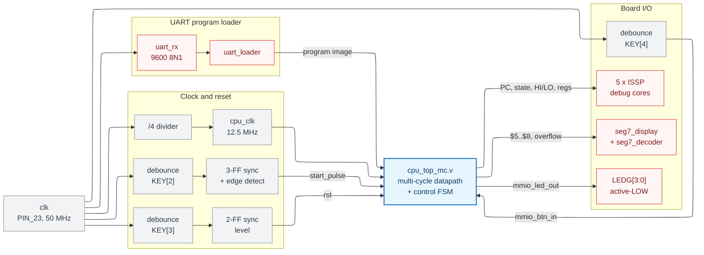

**Clock domains.** Everything left of `cpu_top_mc`'s clock input runs on the raw
50 MHz clock: the debouncers (timing calibrated in real milliseconds), the UART
receiver (baud timing must be precise), the UART loader, and the `imem` write
port. The CPU itself runs on `cpu_clk` (50 / 4 = 12.5 MHz). Only two signals
cross into `cpu_clk` — `rst` and `start_pulse` — and both are synchronized first.

---

## 2. Datapath — structural view

`cpu_top_mc.v` holds *all* state; the FSM holds none. The FSM observes a few
status signals and issues latch enables.

### 2.1 Data flow

This shows the **data path only**. The control signals are deliberately omitted:
there are 18 of them fanning out from a single FSM node, and drawing each as an
edge turns the diagram into an unreadable web. They are tabulated in §2.4.

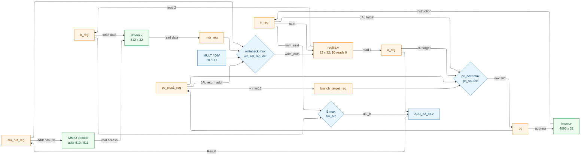

### 2.2 Field decode

Decoded combinationally from the **latched** instruction, so the fields stay
valid through ID/EX/MEM/WB — not just during IF.

```
  31            26 25      21 20      16 15      11 10        6 5        0
 ┌────────────────┬──────────┬──────────┬──────────┬───────────┬──────────┐
 │  opcode [5:0]  │   rs     │   rt     │   rd     │    (0)    │ funct[5:0]│
 └────────────────┴──────────┴──────────┴──────────┴───────────┴──────────┘
```

| Source slice | Field | Notes |
|---|---|---|
| `ir_reg[31:26]` | `opcode[5:0]` | Selects the instruction class |
| `ir_reg[25:21]` | `rs[4:0]` | First source register |
| `ir_reg[20:16]` | `rt[4:0]` | Second source, or destination for I-type |
| `ir_reg[15:11]` | `rd[4:0]` | R-type destination |
| `ir_reg[5:0]` | `funct[5:0]` | R-type operation selector |
| `ir_reg[15:0]` | `imm16[15:0]` | Sign-extended to `imm_sext[31:0]` |
| `ir_reg[11:0]` | `jump_target[11:0]` | JAL absolute target |

### 2.3 The three output muxes

| `write_data` mux (priority — first match wins) | Selects |
|---|---|
| `reg_dst == 2` | `{25'b0, pc_plus1_reg}` — JAL return address |
| `wb_sel == 1` | `mdr_reg` — LW, from memory |
| `wb_sel == 2` | `hi_reg` — MFHI |
| `wb_sel == 3` | `lo_reg` — MFLO |
| otherwise | `alu_out_reg` — R-type / ADDI |

| `write_reg` mux | Selects |
|---|---|
| `reg_dst == 2` | `$31` — JAL |
| `reg_dst == 1` | `rt` — ADDI, LW |
| `reg_dst == 0` | `rd` — R-type, MFHI, MFLO |

| `pc_next` mux (`pc_source`) | Selects |
|---|---|
| `2'd0` | `pc_plus1_reg` — fall-through |
| `2'd1` | `branch_target_reg` — BEQ / BNE taken |
| `2'd2` | `jump_target` = `ir_reg[11:0]` — JAL (absolute) |
| `2'd3` | `a_reg[11:0]` — JR |

The PC updates **once per instruction, during EX**, for every instruction type.

### 2.4 Control and status signals

These are the edges omitted from §2.1.

| Direction | Signals |
|---|---|
| Out — latch enables | `ir_write`, `pc_plus1_write`, `ab_write`, `branch_target_write`, `alu_out_write`, `pc_write`, `mdr_write`, `md_init`, `md_step`, `hi_write`, `lo_write` |
| Out — mux selects | `alu_op[3:0]`, `alu_src`, `pc_source[1:0]`, `reg_write`, `reg_dst[1:0]`, `wb_sel[1:0]`, `dmem_write` |
| In — status | `ir_reg`, `regs_equal` (`a_reg == b_reg`), `alu_ov`, `md_counter_done` |

---

## 3. Instruction lifecycle

The normal execution path — one shared datapath, reused 3–5 times per
instruction. The complete FSM, including `TRAP` and `HALT`, is in §6.2.

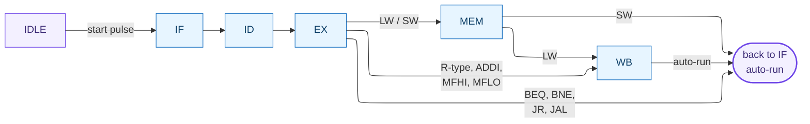

`rst` returns the FSM to `IDLE` from any state. The three terminal states — `WB`,
`MEM` after an `SW`, and `EX` for the branches and jumps — all converge on the
same `back to IF` node, which is what makes a single `KEY[2]` press run the
entire program.

---

## 4. ALU internals (`ALU_32_bit.v`)

Patterson & Hennessy style: 31 identical `alu_1bit` slices plus an `alu_1Xbit`
slice for the MSB that additionally exposes its raw sum bit for `SLT`.

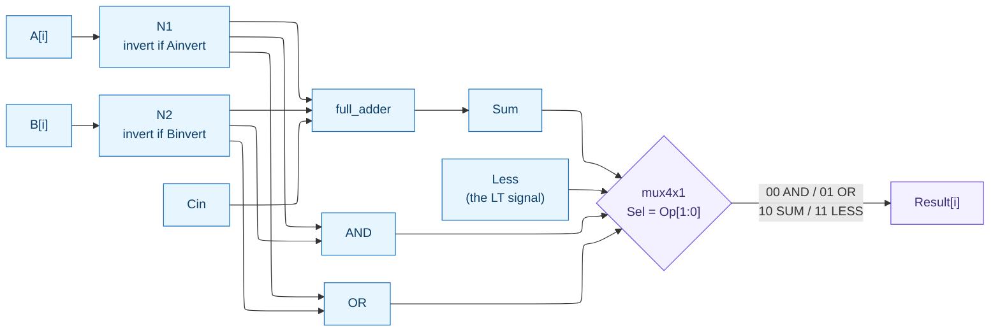

**MSB slice (bit 31).** Identical to the above, plus two extra outputs:
`Set = Sum` (the raw sum bit, exported so the top level can build `LT`) and
`Cout` (the final carry out).

**Bit-0 special cases.** Only slice 0 takes `Cin = Op[2]` — this supplies the
`+1` that makes `SUB` work. Only slice 0 receives `LT`, the SLT comparison
result. Every other slice takes the carry from the slice below.

| Top-level flag | Expression |
|---|---|
| `Cout` | carry out of bit 31 |
| `Ov` | `Carry[30] ^ Cout` — signed overflow, carry-in XOR carry-out of MSB |
| `LT` | `Ov ^ Set` — SLT result, corrected when overflow occurred |

**Op encoding** — `Op = {Ainvert, Binvert, Op[1:0]}`:

| `Op[3:0]` | Operation |
|---|---|
| `4'b0000` | AND |
| `4'b0001` | OR |
| `4'b0010` | ADD |
| `4'b0110` | SUB — `A + ~B + 1`, via Binvert=1, Op=10, Cin=1 |
| `4'b0111` | SLT — `Result = LT` |
| `4'b1100` | NOR — Ainvert=1, Binvert=1, Op=00 → `~A & ~B` |

---

## 5. MULT / DIV unit

Both operations share one 64-bit working register and one 32-cycle state
(`MD_LOOP`), selected by `is_mult` / `is_div`. Sharing storage is safe because
`ir_reg` is stable, so only one can ever be in flight.

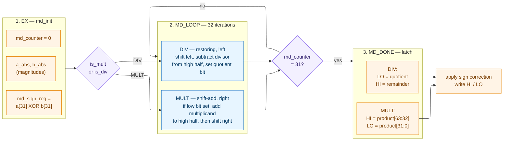

**Initialisation.** `MULT` loads `md_b_reg` with the multiplicand (`a_abs`) and
`md_product_reg` with the multiplier in the low half. `DIV` loads `md_b_reg`
with the divisor (`b_abs`) and the dividend in the low half.

**Loop body.** `MULT` conditionally adds and shifts right. `DIV` shifts left,
subtracts the divisor from the high half, and either restores (shifting in `0`)
or keeps the result (shifting in `1`).

**Result.** After 32 steps the **quotient sits in the low half and the remainder
in the high half** — exactly the MIPS `LO`/`HI` convention, so no reshuffling is
needed. The remainder takes the **dividend's** sign (`a_reg[31]`), matching real
MIPS. `HI` and `LO` are read back through the write-back mux by `MFHI`
(`wb_sel = 2`) and `MFLO` (`wb_sel = 3`).

---

## 6. Control FSM (`control_unit_mc.v`)

### 6.1 Transition table (authoritative)

| State | Encoding | Next state |
|---|---|---|
| `IDLE` | `4'd0` | `IF` if `start`, else `IDLE` |
| `IF` | `4'd1` | `ID` |
| `ID` | `4'd2` | `EX` |
| `EX` | `4'd3` | `TRAP` if illegal, else `HALT` if halt, else `MD_LOOP` if mult/div, else `MEM` if lw/sw, else `WB` if rtype/addi/mfhi/mflo, else **`IF`** |
| `MEM` | `4'd4` | `WB` if `lw`, else `IF` |
| `WB` | `4'd5` | `IF` |
| `TRAP` | `4'd6` | `TRAP` (absorbing) |
| `MD_LOOP` | `4'd7` | `MD_DONE` if `md_counter_done`, else `MD_LOOP` |
| `MD_DONE` | `4'd8` | `IF` |
| `HALT` | `4'd9` | `HALT` (absorbing) |

### 6.2 State diagram

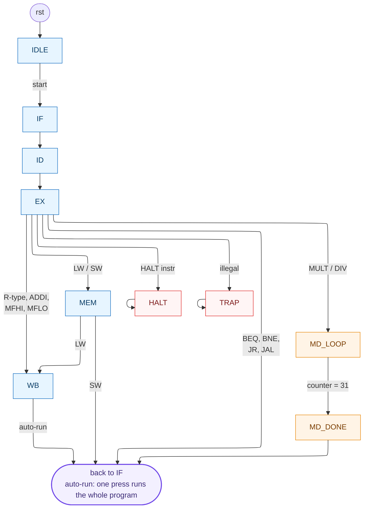

Every edge above is one row of the §6.1 table, with `md_counter_done` written out
as `counter = 31`. The `back to IF` node collapses the five transitions into
`IF` (`WB`, `MD_DONE`, `MEM` on `SW`, and `EX` on the branches/jumps) into a
single rail, which both matches the "auto-run" behaviour and keeps the graph
acyclic so ELK can lay it out in execution order.

**Auto-run.** Every instruction returns to `IF`, not `IDLE`. `IDLE` is entered
only once, after reset, so a single `KEY[2]` press runs the entire program.

**Absorbing states.** `TRAP` (illegal opcode) and `HALT` (explicit stop) are
permanent — only `rst` leaves them. The sticky `illegal_opcode` flag latches when
`TRAP` is entered.

### 6.3 Control signals asserted per state

| Signal | IDLE | IF | ID | EX | MEM | WB | MD_LOOP | MD_DONE | TRAP | HALT |
|---|---|---|---|---|---|---|---|---|---|---|
| `ir_write` | | ● | | | | | | | | |
| `pc_plus1_write` | | ● | | | | | | | | |
| `ab_write` | | | ● | | | | | | | |
| `branch_target_write` | | | ● | | | | | | | |
| `alu_out_write` | | | | ● | | | | | | |
| `pc_write` | | | | ● | | | | | | |
| `mdr_write` | | | | | ● | | | | | |
| `md_init` | | | | ● ¹ | | | | | | |
| `md_step` | | | | | | | ● | | | |
| `hi_write` | | | | | | | | ● | | |
| `lo_write` | | | | | | | | ● | | |
| `dmem_write` | | | | | ● ² | | | | | |
| `reg_write` | | | | ● ³ | | ● ⁴ | | | | |

¹ MULT / DIV only  
² SW only  
³ JAL only (`$31` ← `pc_plus1_reg`)  
⁴ rtype / addi / lw / mfhi / mflo only

---

## 7. Memory map and MMIO decode

`dmem` keeps a 9-bit address, so the low 9 bits of a computed address select the
word from the 512-word space. Two addresses are intercepted **before** reaching
`dmem.v`, leaving that module completely unmodified.

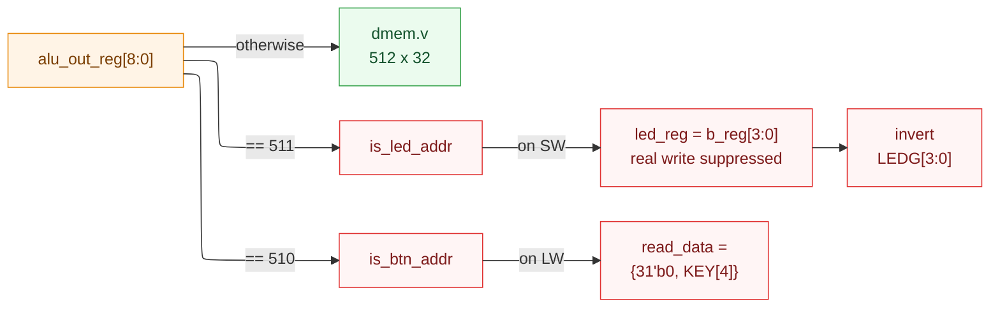

| Address | `LW` | `SW` |
|---|---|---|
| `0`–`509` | ordinary `dmem` read | ordinary `dmem` write |
| `510` | **MMIO** → `{31'b0, KEY[4]}` | ordinary write to `mem[510]` |
| `511` | ordinary read of `mem[511]` | **MMIO** → `led_reg[3:0]` |

The asymmetry means `mem[510]` is unreachable via `LW` and `mem[511]` unreachable
via `SW`, but each stays reachable in the other direction.

The button input passes through a 2-FF synchronizer (`btn_sync1` / `btn_sync2`)
inside `cpu_top_mc.v`, since it arrives from a different clock domain.

---

## 8. Clock, reset, and clock-domain crossing

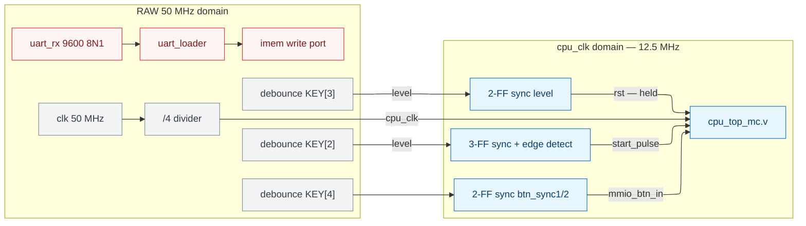

`start` is edge-detected **inside the `cpu_clk` domain**, not the fast one. A
single-cycle pulse generated at 50 MHz could be too narrow for a 12.5 MHz clock
to ever sample; synchronizing the *level* first and then edge-detecting
guarantees a pulse a full `cpu_clk` period wide.

`rst` is deliberately a **level**, not a pulse — holding the button holds reset.

---

## 9. ISSP debug probe layout

Five `altera_in_system_sources_probes` cores, clocked from the JTAG domain.
Word *n* within an instance occupies bits `[32n+31 : 32n]`, with no gaps.

> The whole probe section is compile-time optional (the `CPU_ISSP` macro in the
> `.qsf`). It ships disabled because the probes plus the display register select
> exceed the device's logic.

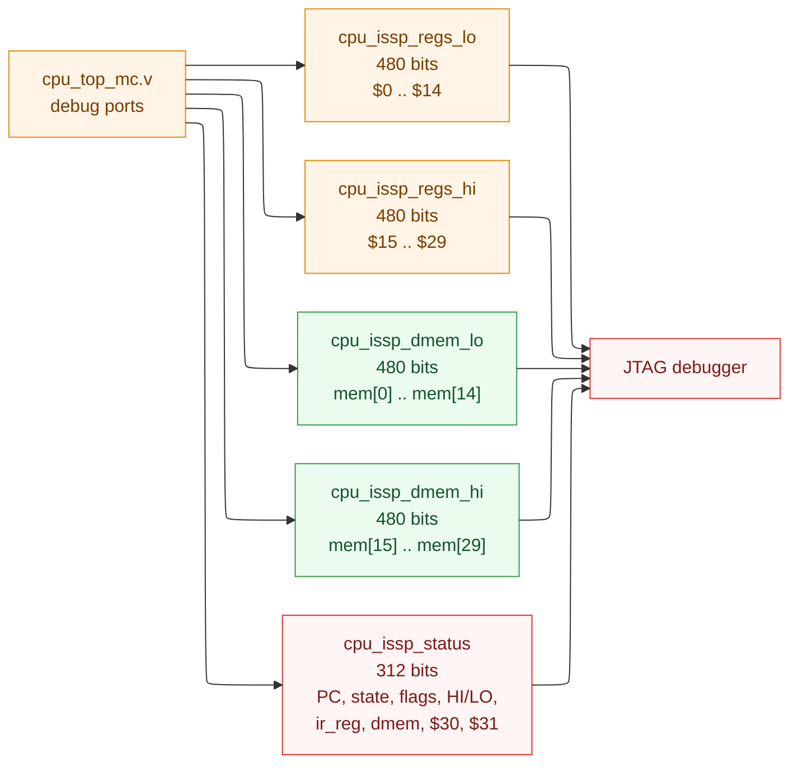

| Core | Width | Bits `[31:0]` | Bits `[479:448]` |
|---|---|---|---|
| `cpu_issp_regs_lo` | 480 | `$0` (tied to constant 0) | `$14` |
| `cpu_issp_regs_hi` | 480 | `$15` | `$29` |
| `cpu_issp_dmem_lo` | 480 | `mem[0]` | `mem[14]` |
| `cpu_issp_dmem_hi` | 480 | `mem[15]` | `mem[29]` |

So `cpu_issp_regs_lo` holds `$0`–`$14` and `cpu_issp_regs_hi` holds `$15`–`$29`,
packed at `$n` → bits `[32n+31 : 32n]`. The memory cores follow the same pattern
for `mem[0]`–`mem[14]` and `mem[15]`–`mem[29]`.

### `cpu_issp_status` — 312 bits

| Bits | Width | Contents |
|---|---|---|
| `[311:300]` | 12 | PC |
| `[299:296]` | 4 | FSM state |
| `[295]` | 1 | sticky overflow flag |
| `[294]` | 1 | sticky illegal-opcode flag |
| `[293:262]` | 32 | HI |
| `[261:230]` | 32 | LO |
| `[229:198]` | 32 | `ir_reg` (current instruction) |
| `[197:193]` | 5 | dmem address |
| `[192:161]` | 32 | dmem write data |
| `[160]` | 1 | dmem write enable |
| `[159:128]` | 32 | dmem read data |
| `[127:96]` | 32 | `$30` |
| `[95:64]` | 32 | `$31` |
| `[63:32]` | 32 | `mem[30]` |
| `[31:0]` | 32 | `mem[31]` |

**Why this grouping:** `ALTSOURCE_PROBE` has a hard **511-bit `PROBE_WIDTH`
limit** — 16 words × 32 bits = 512 bits is rejected. Each core therefore carries
15 words (480 bits), and the four leftovers (`$30`, `$31`, `mem[30]`, `mem[31]`)
are folded into the status core, which has headroom.

---

## 10. Instruction timing

Cycles on `cpu_clk` (12.5 MHz). **Row length is proportional to the cycle
count** — note how much longer `MULT` / `DIV` is than everything else.

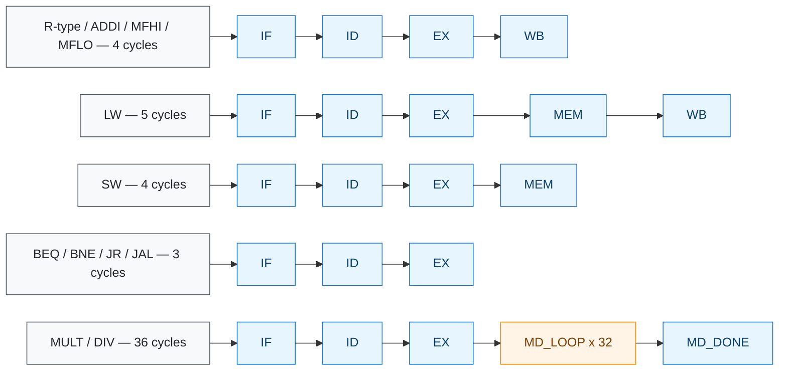

| Instruction | States | Cycles |
|---|---|---|
| ADD, SUB, AND, OR, SLT | IF, ID, EX, WB | 4 |
| ADDI | IF, ID, EX, WB | 4 |
| MFHI, MFLO | IF, ID, EX, WB | 4 |
| LW | IF, ID, EX, MEM, WB | 5 |
| SW | IF, ID, EX, MEM | 4 |
| BEQ, BNE | IF, ID, EX | 3 |
| JR, JAL | IF, ID, EX (JAL writes `$31` in EX) | 3 |
| MULT, DIV | IF, ID, EX, 32 × MD_LOOP, MD_DONE | 36 |
| HALT | IF, ID, EX, then stuck | 3 |
| illegal opcode | IF, ID, EX, then stuck | 3 |

`IDLE` is not counted — it is visited once after reset, then never again.

---

## 11. Module dependency graph

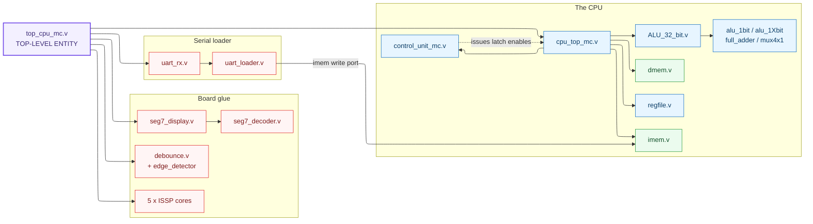

**Not in the build** (removed during the repository cleanup, recoverable from
git commit `c64214a`): `cpu_top.v`, `top_cpu.v`, `control_unit.v`, and the legacy
ISSP cores `cpu_issp_lo`, `cpu_issp_hi`, `cpu_issp_mem`, `cpu_issp_dmem2`,
`cpu_issp_dmem3`.
