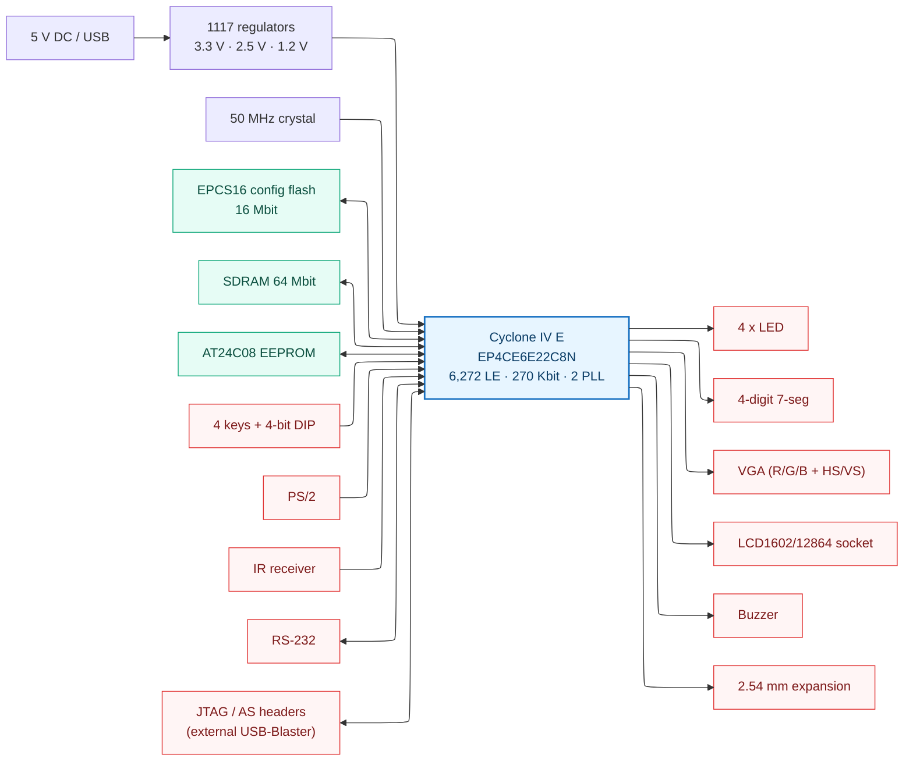

# RZ-EasyFPGA A2.2 — Board & FPGA Reference

Board-level reference for the **RZ-EasyFPGA A2.2**, the Altera/Intel Cyclone IV E
development board this CPU project targets. Companion to
[`../README.md`](../README.md) (project) and
[`../ARCHITECTURE.md`](../ARCHITECTURE.md) (RTL diagrams).

> **Scope.** Part 1–11 document the *board and its FPGA* from vendor listings and
> the community pinout; Part 12 maps that onto *this project*. Where a number
> comes from a single seller description it is marked as such — treat the vendor
> spec sheet as indicative, not a datasheet.

---

## 1. What it is

The RZ-EasyFPGA A2.2 is a low-cost (~US$30–40 on AliExpress) Cyclone IV E
teaching/prototyping board, one of a family of near-identical "–EasyFPGA"
boards (also sold as "Cyclone IV board V3.0", "KitEasyFPGA", etc.) that all
share a common layout and pinout. It is a **bare FPGA board**, not a
microcontroller board: there is no on-board USB-Blaster, so an external Altera
USB-Blaster (or clone) is required to program it.

It is aimed squarely at digital-logic coursework and hobby projects — blinking
LEDs, 7-segment displays, VGA, PS/2, serial — and is popular precisely because
the whole Quartus Prime **Lite** toolchain supports its device for free. Its
documentation is community-driven rather than vendor-official, which is why a
canonical pinout file (the `rz_easyfpga_2_2.qsf`) circulates on GitHub.

---

## 2. Board specifications

| Item | Value |
|---|---|
| FPGA | Altera/Intel **Cyclone IV E `EP4CE6E22C8N`** (EQFP-144) |
| Configuration flash | **EPCS16** 16 Mbit serial config device (community also reports an M25P16, a pin-compatible 16 Mbit part) |
| SDRAM | **64 Mbit** (8 MB), on-board |
| I²C EEPROM | **AT24C08** (1 Kbit), for I²C bus experiments |
| Clock | **50 MHz** crystal oscillator |
| Power input | **DC 5 V** barrel jack, or USB |
| Regulators | **1117-3.3 V** (I/O), **1117-1.2 V** (VCCINT core), **1117-2.5 V** (VCCA PLL) |
| Programming headers | **JTAG** (`.sof`, volatile) and **AS** (`.pof`, non-volatile) |
| Expansion | All FPGA pins broken out on 2.54 mm headers |
| Board size | 136 mm × 106 mm |
| Toolchain | Quartus Prime **Lite** (Cyclone IV E device support) |

### On-board peripherals

1. Self-locking power switch, 1 reset key, **4 user keys**
2. **4 LEDs**
3. **4-digit 7-segment display**
4. **4-bit DIP switch**
5. Buzzer
6. **PS/2** connector
7. **RS-232** serial port
8. **VGA** port (RGB via resistor DAC — see §10)
9. 1×20 LCD socket (supports LCD1602 / LCD12864 / TFT), with a precision
   trimpot for LCD backlight/contrast
10. Temperature sensor (LM75A class)
11. Infrared receiver module
12. I²C serial EEPROM (AT24C08)

---

## 3. The FPGA: Cyclone IV E `EP4CE6E22C8N`

### 3.1 Part number decode

```
  EP4C E 6 E22 C8 N
  │    │ │ │   │  │
  │    │ │ │   │  └─ N  = lead-free / RoHS package
  │    │ │ │   └──── C8 = commercial temp (0…85 °C), speed grade -8
  │    │ │ └──────── E22 = EQFP-144 package
  │    │ └────────── 6   = ~6.3K logic-element density
  │    └──────────── E   = Cyclone IV **E** subfamily (no transceivers)
  └───────────────── EP4C = Cyclone IV family
```

`EP4CE6E22C8` (without the trailing `N`) is exactly what Quartus stores in the
`.qsf` — Quartus ignores the lead-free suffix for device selection, and every
"EP4CE6E22C8N" board is programmed as `EP4CE6E22C8`.

### 3.2 Device resources

| Resource | `EP4CE6` |
|---|---|
| Logic elements (LEs) | **6,272** |
| M9K embedded memory blocks | **30** (270 Kbit) |
| Embedded 18×18 multipliers | **15** |
| PLLs | **2** |
| Global clock networks | **10** |
| Max user I/O | 179 (BGA `F17`); ~91 on the EQFP-144 `E22` package |
| Core voltage (VCCINT) | 1.2 V |

Quartus reports multipliers in **9-bit** terms, so a fitter summary for this
device shows **30** multipliers (15 × 18×18 split into 9-bit halves). Likewise
this project's fit summary reports `23 / 92` pins used — 92 is the fitter's
usable-pin count for the `E22` package including the dedicated clock input.

### 3.3 Where it sits in the Cyclone IV E family

| Device | LEs | Embedded memory | M9K blocks | 18×18 mult. | PLLs |
|---|---|---|---|---|---|
| **EP4CE6** | **6,272** | **270 Kbit** | **30** | **15** | **2** |
| EP4CE10 | 10,320 | 414 Kbit | 46 | 23 | 2 |
| EP4CE15 | 15,408 | 504 Kbit | 56 | 56 | 4 |
| EP4CE115 | 114,480 | 3,888 Kbit | 432 | 266 | 4 |

The EP4CE6 is the entry device — enough for UARTs, SPI/I²C masters, a VGA
controller, PWM, and small soft processors, but **not** enough for a practical
Nios II system. It is built on a 60 nm process and comes in EQFP-144 (this
board) or FBGA-256 packages. Note the family is mature/legacy: Intel keeps it in
"maintenance mode" in Quartus, but devices remain in production and the free
tooling is complete.

> **Variant caution:** one academic paper and one blog cite the A2.2 as carrying
> an `EP4CE8`. The overwhelming majority of sources, the canonical community
> pinout file, and this project's own `.qsf` all say **`EP4CE6E22C8`**. Assume
> EP4CE6 unless your board's chip reads otherwise.

---

## 4. Power

The board takes **5 V** (barrel jack or USB) and derives three rails with
AMS1117-class linear regulators:

| Rail | From | Feeds |
|---|---|---|
| 3.3 V | 1117-3.3 | FPGA VCCIO / I/O banks, most peripherals |
| 1.2 V | 1117-1.2 | FPGA **VCCINT** (core logic) |
| 2.5 V | 1117-2.5 | FPGA **VCCA** (PLL analog supply) |

The 2.5 V PLL rail matters even if you never instantiate a PLL: on Cyclone IV,
leaving VCCA unpowered can cause configuration failures instead of a clean
"PLL unused" result. Since the board supplies it, that is only a concern for
custom designs.

---

## 5. Clocking

A single **50 MHz** crystal drives the FPGA clock pin. There is no on-board
programmable oscillator, so every derived frequency (VGA pixel clock, baud
rates, CPU clock) must be generated internally from 50 MHz — by a counter
divider or one of the two PLLs.

---

## 6. Configuration & programming

Cyclone IV devices are SRAM-based: the bitstream lives in volatile configuration
memory, and the board's EPCS16 flash provides the non-volatile copy loaded at
power-up.

| Method | Header | File | Survives power cycle? |
|---|---|---|---|
| **JTAG** | JTAG | `.sof` | **No** — fast, for development |
| **Active Serial (AS)** | AS | `.pof` | **Yes** — writes EPCS16 |
| JTAG indirect (JIC) | JTAG | `.jic` | **Yes** — writes EPCS16 over JTAG |

- **JTAG / `.sof`** is the everyday development path: fastest to iterate, but
  the design vanishes on power-off.
- **AS / `.pof`** programs the EPCS16 directly so the FPGA auto-configures at
  power-up. Both the AS and JTAG headers exist on this board.
- **JIC** reaches the same persistent result *through the JTAG header* — Quartus
  → *Convert Programming Files* → JTAG Indirect Configuration File (`.jic`),
  select the EPCS16 and the target `EP4CE6`, then program via JTAG.

An external **USB-Blaster** is required; the board has no on-board programmer.
On Windows the driver usually installs automatically; on Linux you need the
Altera udev rules (`idVendor 09fb`) and, on some distros, a 32-bit `libudev`.

---

## 7. Complete pin map

The pinout below is the community "master" assignment
(`rz_easyfpga_2_2.qsf`) and matches this project's `.qsf` for every signal the
project uses.

### Clock, keys, switches

| Signal | Pin | Notes |
|---|---|---|
| `CLOCK_50` | `PIN_23` | 50 MHz oscillator |
| `KEY[0]` | `PIN_88` | User key 0 |
| `KEY[1]` | `PIN_89` | User key 1 |
| `KEY[2]` | `PIN_90` | User key 2 |
| `KEY[3]` | `PIN_91` | User key 3 |
| `KEY[4]` | `PIN_25` | Spare key / reset key (see §10) |

The four user keys are shared with the **4-bit DIP switch** — the DIP switches
and push buttons drive the same FPGA pins (the keys have pull-ups, so a DIP
switch set "on" holds the line against the button).

### LEDs and 7-segment display

| Signal | Pin | Notes |
|---|---|---|
| `LEDG[0..3]` | `PIN_87, 86, 85, 84` | 4 LEDs — **active-LOW** |
| `SEG[0..7]` | `PIN_128, 121, 125, 129, 132, 126, 124, 127` | Segments a–g + DP, **active-LOW** |
| `DIG[0..3]` | `PIN_133, 135, 136, 137` | Digit select, **active-LOW** |

### Buzzer, serial, I²C, PS/2, IR

| Signal | Pin | Notes |
|---|---|---|
| `BEEP` | `PIN_110` | Buzzer |
| `UART_TXD` | `PIN_114` | FPGA → RS-232 |
| `UART_RXD` | `PIN_115` | RS-232 → FPGA |
| `SCL` / `SDA` | `PIN_112` / `PIN_113` | I²C bus A |
| `I2C_SCL` / `I2C_SDA` | `PIN_99` / `PIN_98` | I²C bus B (AT24C08 EEPROM) |
| `PS2_CLK` / `PS2_DAT` | `PIN_119` / `PIN_120` | PS/2 keyboard |
| `IRDA_RXD` | `PIN_100` | Infrared receiver |

> Note this board has **two** I²C pin pairs broken out (`112/113` and `98/99`),
> not a discrepancy — check the schematic for which one the EEPROM sits on.

### VGA

| Signal | Pin | Notes |
|---|---|---|
| `VGA_HS` | `PIN_101` | Horizontal sync |
| `VGA_VS` | `PIN_103` | Vertical sync |
| `VGA_R` | `PIN_106` | Red, 1 bit |
| `VGA_G` | `PIN_105` | Green, 1 bit |
| `VGA_B` | `PIN_104` | Blue, 1 bit |

### LCD socket

| Signal | Pin |
|---|---|
| `LCD_RS` | `PIN_141` |
| `LCD_RW` | `PIN_138` |
| `LCD_EN` | `PIN_143` |
| `LCD_DATA[0..7]` | `PIN_142, 1, 144, 3, 2, 10, 7, 11` |

### SDRAM (64 Mbit)

| Signal | Pins |
|---|---|
| `SDRAM_DQ[0..15]` | `28, 30, 31, 32, 33, 34, 38, 39, 54, 53, 52, 51, 50, 49, 46, 44` |
| `SDRAM_A[0..11]` | `76, 77, 80, 83, 68, 67, 66, 65, 64, 60, 75, 59` |
| `SDRAM_BS0` / `BS1` | `PIN_73` / `PIN_74` |
| `SDRAM_LDQM` / `UDQM` | `PIN_42` / `PIN_55` |
| `SDRAM_CKE` | `PIN_58` |
| `SDRAM_CLK` | `PIN_43` |
| `SDRAM_CS` / `RAS` / `CAS` / `WE` | `PIN_72` / `PIN_71` / `PIN_70` / `PIN_69` |

---

## 8. Expansion headers and I/O

All FPGA pins are broken out on 2.54 mm headers, so the board doubles as a
breakout for the whole EQFP-144 device. This is where most custom wiring goes.

- The board's I/O is **3.3 V LVCMOS/LVTTL**. Do not drive 5 V logic directly into
  FPGA pins.
- Cyclone IV E organises I/O into **8 banks**, each with one VCCIO rail. On a
  fixed board this is transparent, but if you assign pins with mixed I/O
  standards, keep in mind that all pins in a bank share that bank's supply.
- For designs that don't use every pin, set *Reserve all unused pins* to
  **As input tri-stated** (Quartus → Device → Unused Pins) so floating header
  pins can't cause excess current or spurious toggling.

---

## 9. Board-level block diagram



---

## 10. Board quirks & known gotchas

These are the things that actually bite people on this specific board:

1. **LEDs are active-LOW.** Driving a `1` turns an LED *off*. Verified on
   hardware in this project.
2. **7-segment segments and digit selects are active-LOW** too.
3. **Keys are active-LOW and need debouncing.** They also share pins with the
   DIP switch, and have redundant pull-ups.
4. **The push buttons sit on global-clock-capable pins.** A community reviewer
   noted the 4 user keys land on dedicated global clock inputs, and the reset
   line uses a global clock input. That is convenient for a clock-like signal but
   means the keys are not "ordinary" I/O in the pin planner.
5. **VGA colour is 1 bit per channel.** Only resistors for R, G, and B are
   present (no resistor ladder), so you get **8 colours** (2³), not the 512 a
   3-bit-per-channel DAC would give.
6. **No on-board programmer.** Budget for a USB-Blaster and its driver/udev
   setup.
7. **Vendor docs are thin and sometimes wrong.** The canonical pinout is the
   community `rz_easyfpga_2_2.qsf`; cross-check anything against your board's
   silkscreen and schematic.
8. **Component-name typos in listings.** e.g. the temperature sensor is listed
   as "LM754A", almost certainly an **LM75A**. Treat peripheral part numbers as
   approximate.

---

## 11. Toolchain

| Item | Detail |
|---|---|
| IDE | **Quartus Prime Lite Edition** (Standard also works) |
| Needed package | **Cyclone IV device support** — a separate download/install step |
| Device to select | Family `Cyclone IV E`, device **`EP4CE6E22C8`** (not the `…C8L` low-power variant) |
| Programmer | External USB-Blaster (JTAG), plus AS header for `.pof` |
| Simulation | ModelSim/Questa Intel FPGA Starter Edition (optional) |

Notes:

- Install to a path **without spaces** (e.g. `C:\intelFPGA_lite\22.1std`) —
  Quartus is known to misbehave otherwise.
- Community reports run the board successfully on Quartus 18.0 through 25.1;
  this project uses **25.1std Lite**.
- A minimal "hello world" needs only `clk` (PIN_23) and the four LEDs
  (`PIN_87/86/85/84`), plus the device-support package.
- Pin assignments are easiest to import from a text/Tcl list or by copying the
  community `.qsf` rather than clicking each pin in the Assignment Editor.

---

## 12. How *this* project uses the board

`top_cpu_mc.v` is the board top-level. It uses a small subset of the board:

| Signal | Pin(s) | Role in this project |
|---|---|---|
| `clk` | `PIN_23` | 50 MHz → divided internally to `cpu_clk` = 12.5 MHz |
| `KEY[0]` | `PIN_88` | Step which register the display shows |
| `KEY[1]` | `PIN_89` | Held: show the register *index* instead of its value |
| `KEY[2]` | `PIN_90` | **Start / run** — one press runs the whole program |
| `KEY[3]` | `PIN_91` | **Reset** (held level) |
| `KEY[4]` | `PIN_25` | Memory-mapped input button (`LW` from address 510) |
| `SEG[0..7]` | `PIN_128…127` | 7-segment data (DP lights on sticky overflow) |
| `DIG[0..3]` | `PIN_133,135,136,137` | Digit select |
| `LEDG[0..3]` | `PIN_87,86,85,84` | Memory-mapped output (`SW` to address 511), active-LOW |
| `UART_RXD` | `PIN_115` | 9600-baud program loader into `imem` |

Everything else on the board (SDRAM, VGA, LCD, PS/2, IR, I²C EEPROM) is unused
by this design. The board-specific quirks are handled exactly as §10 warns:
`top_cpu_mc.v` inverts the LEDs and 7-segment at the pin, and debounces all five
keys on the raw 50 MHz clock.

See [`../README.md`](../README.md) §7 for the project's pin table and §1 for the
current fit (92 % logic on this 6,272-LE device).

---

## 13. Sources

- [Rz-Easy FPGA A2.2 Development Board — Makers Electronics (vendor spec + pin list)](https://makerselectronics.com/product/rz-easy-fpga-a2-2-development-board/)
- [inaciose/RZ-easyFPGA-A2.2 — community master pinout `rz_easyfpga_2_2.qsf`](https://github.com/inaciose/RZ-easyFPGA-A2.2)
- [fsmiamoto/EasyFPGA-VGA — board bring-up, VGA details, toolchain notes](https://github.com/fsmiamoto/EasyFPGA-VGA)
- [peach-e — Quartus HelloWorld tutorial + hardware comments (global clock pins, key/DIP sharing)](https://gist.github.com/peach-e/691a0b54b535d70313c97e0af6002aaa)
- [PCBSync — Cyclone IV EP4CE6/EP4CE10 development guide (resources, power, config)](https://pcbsync.com/cyclone-iv-fpga-ep4ce-series/)
- [Intel/Altera — Cyclone IV FPGA product page](https://www.altera.com/products/fpga/cyclone/iv)
- [Intel — Generating a JIC file](https://www.intel.com/content/www/us/en/docs/programmable/683707/current/generating-a-jic-file.html)
- This repository: `Mips_Multi_Cycle_Cpu.qsf`, `top_cpu_mc.v`, `README.md`, `ARCHITECTURE.md`
