# Rendered Architecture Diagrams

Pre-rendered PNGs of every diagram in [`../../ARCHITECTURE.md`](../../ARCHITECTURE.md),
for viewers that cannot render Mermaid with the ELK layout engine (for example
GitHub's built-in renderer, which does not bundle ELK).

These are **generated artefacts**. The Mermaid source in `ARCHITECTURE.md` is
the single source of truth — edit that, then re-render.

---

## 1. System overview (board level)

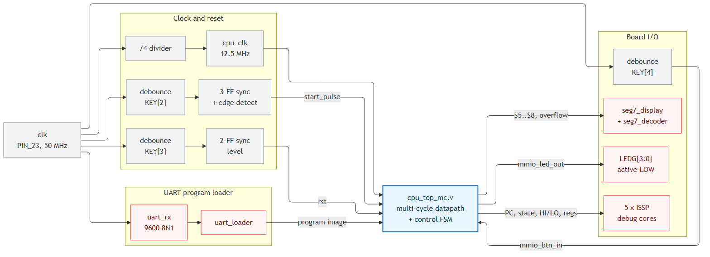

## 2.1 Datapath — data flow

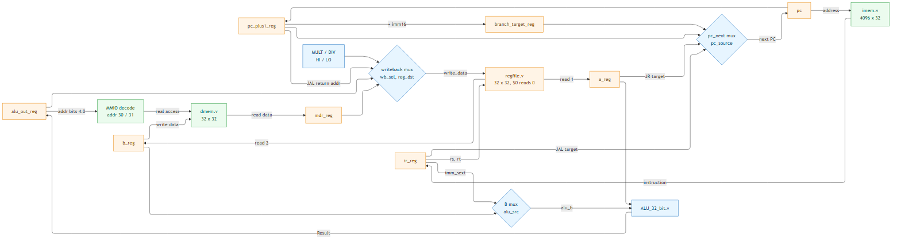

## 3. Instruction lifecycle

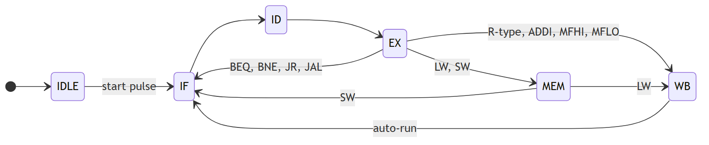

## 4. ALU internals

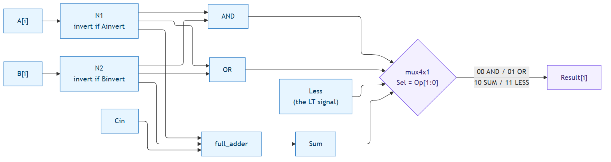

## 5. MULT / DIV unit

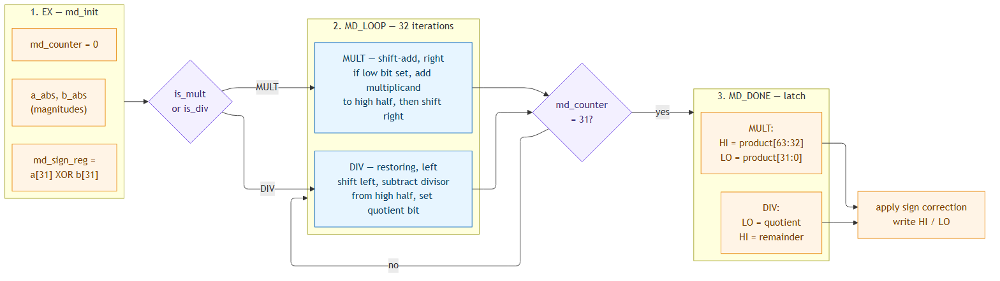

## 6.2 Control FSM state diagram

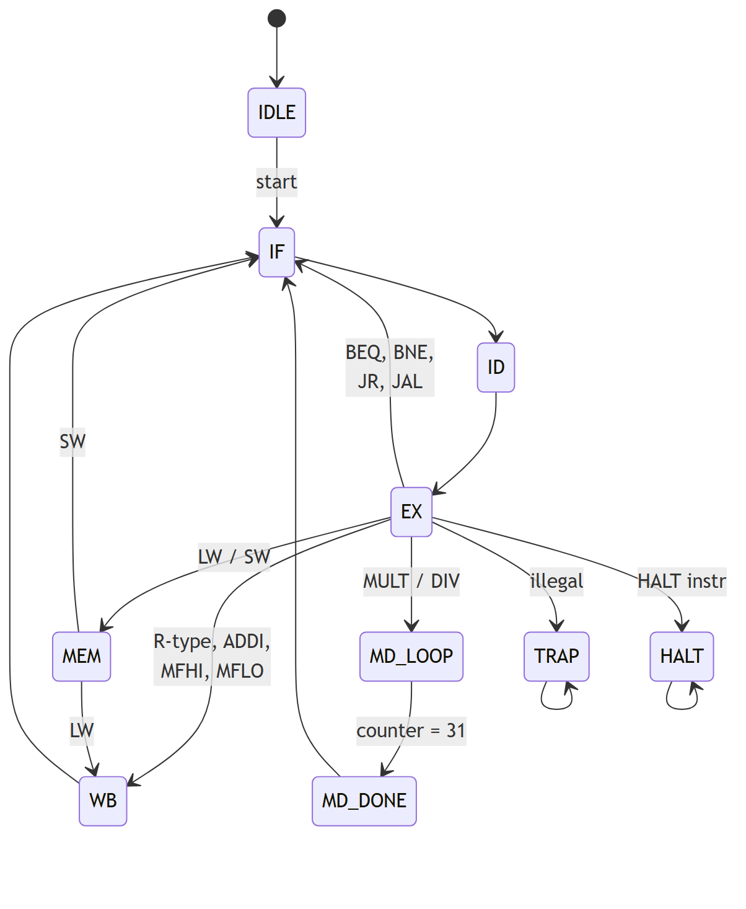

## 7. Memory map and MMIO decode

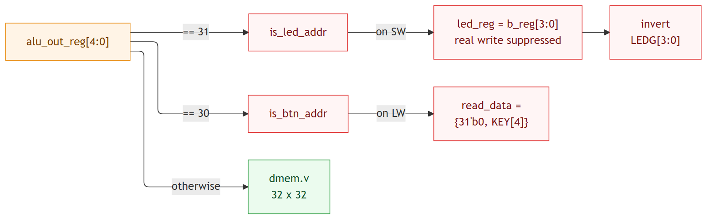

## 8. Clock, reset, and clock-domain crossing

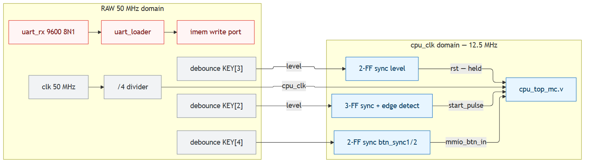

## 9. ISSP debug probe layout

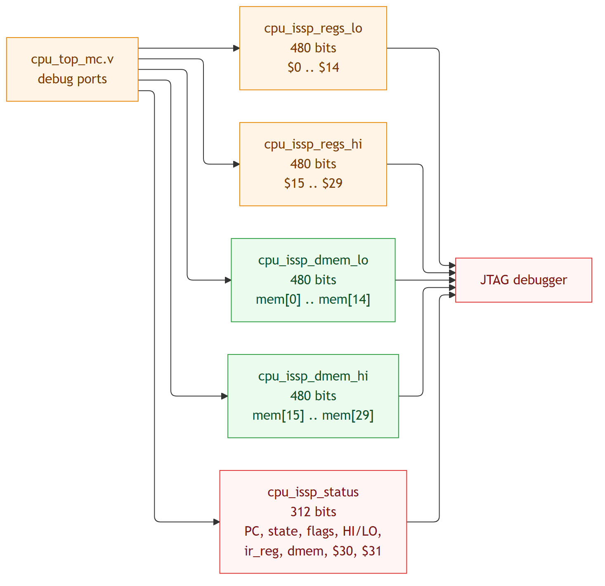

## 10. Instruction timing

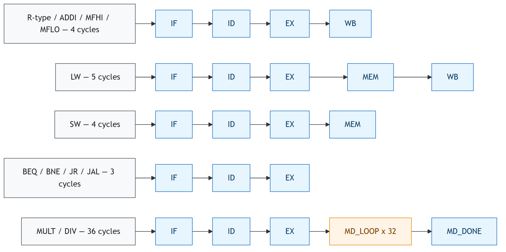

## 11. Module dependency graph

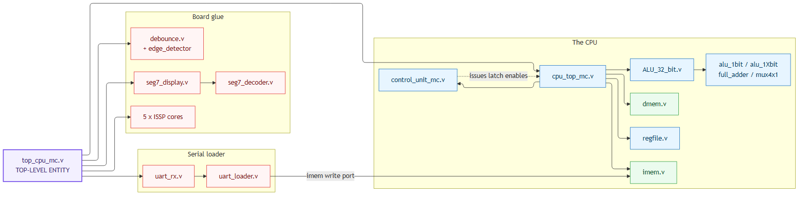

---

## Re-rendering

Requires Node.js, plus Chrome/Chromium (or a downloaded Puppeteer browser).

```bash
npm install @mermaid-js/mermaid-cli @mermaid-js/layout-elk
```

Then, for each diagram, render its code block from `ARCHITECTURE.md`:

```bash
mmdc -i diagram.mmd -o diagram.png -b white -s 2
```

The ELK layout engine is requested per-diagram via the `%%{init: ...}%%`
directive at the top of each flowchart block, so no extra CLI flag is needed
once the `@mermaid-js/layout-elk` package is installed.
